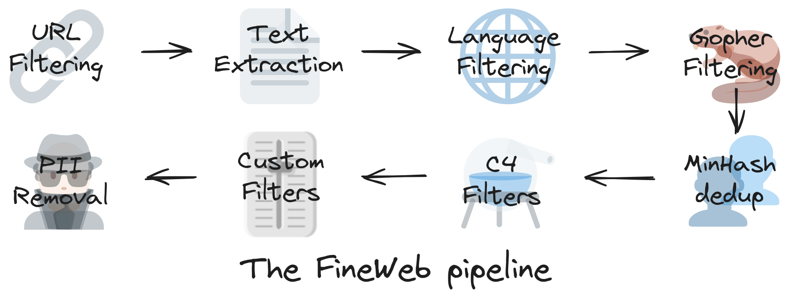

# PRETRAINING

There are multiple stage to build an LLM like ChatGPT. The first stage is called Pre-training stage, and the first step is download and process the internet

## Step 1: Download and process the internet

- Here Andrej gives an example of fineweb (https://huggingface.co/spaces/HuggingFaceFW/blogpost-fineweb-v1).

### Fineweb:
From the page:
> 🍷 FineWeb, a new, large-scale (15-trillion tokens, 44TB disk space) dataset for LLM pretraining. FineWeb is derived from 96 CommonCrawl snapshots and produces better-performing LLMs than other open pretraining datasets. 

- They have also documented their all the design choices (including in-depth investigations of deduplication and filtering strategies).

#### Steps in detail:
1. URL filtering: Applied filtering using a blocklist (https://dsi.ut-capitole.fr/blacklists/) to remove adult content (Site under maintainance when assessed on Nov 23, 2026)

2. Text extraction: Because when we do web-crawling, the output is HTML text, they applied text extraction to extract text.
3. Language filtering: Beacuse internet websites can have different languages, they used a language classifier (fastText language classifier) to keep only Engligh text with a score>=0.65.
4. Gopher filtering: They applied quality and repetition filters from MassiveText paper (https://arxiv.org/abs/2112.11446)
5. MinHash Dedup: Dedup means deduplication. They said
   > Deduplication is one of the most important steps when creating large web datasets for LLM pretraining. Methods to deduplicate datasets attempt to identify and remove redundant/repeated data from the dataset. Removing these duplicates (deduplicating) has been correlated with improvements in model performance and a reduction in memorization of pretraining data, which might allow for better generalization. 
    > Following RefinedWeb, we decided to apply MinHash, a fuzzy hash based deduplication technique that scales efficiently to many CPU-nodes and allows us to tune similarity thresholds (by controlling the number and size of buckets) as well as the length of the subsequences considered (by controlling the n-gram size)

They applied MinHash techniques for dedup.

6. C4 filters: They applied the same filters as on C4 dataset. They mentioned:
   > Still, on our aggregate of tasks, another heavily filtered dataset, the C4 dataset, still showed stronger performances on some benchmarks of our evaluation suite. We therefore set out to find new filtering steps that would, at first, allow us to match the performance of C4 and, at a second stage, surpass it.

C4 data https://huggingface.co/C4/datasets (not public yet). They applied all C4 except the terminal punctuation one.

7. Custom filters: They created a set of heuristic filters:
   > we started by collecting a very large list of high level statistics of our datasets (over fifty different metrics) ranging from common document-level metrics (e.g. number of lines, avg. line/word length, etc) to inter-document repetition metrics (inspired by MassiveText), on both a high quality and a lower quality web dataset;

8. PII removal: The steps are not mentioned on the post. But Andrej described it, saying removing Personal Identitying Information from webpages, such as name, email, address, SSN, etc, before creating the final dataset.