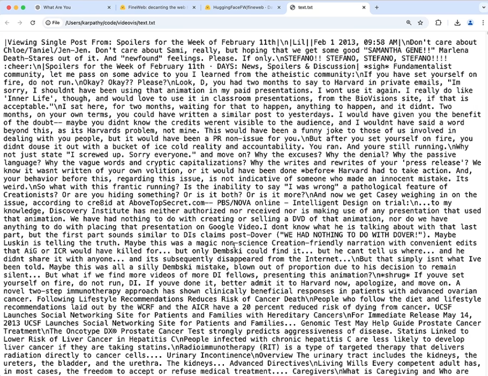
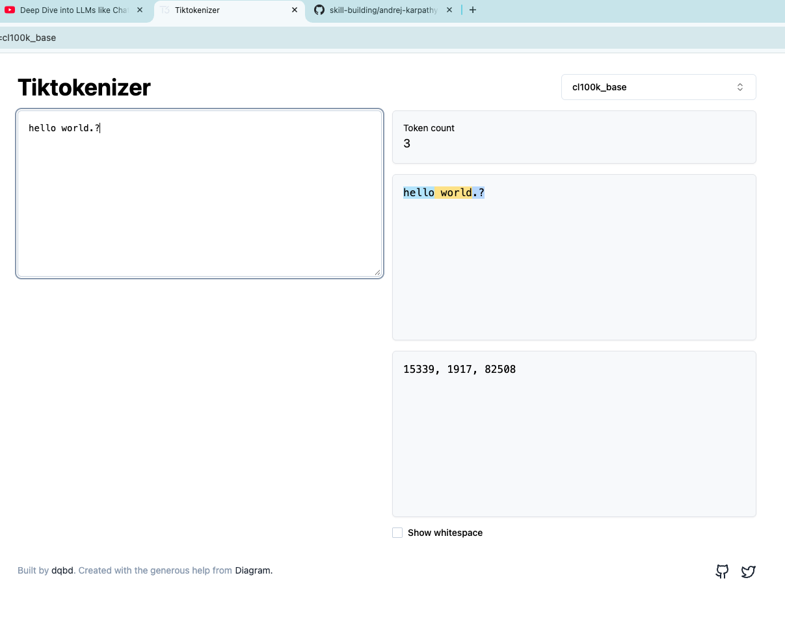
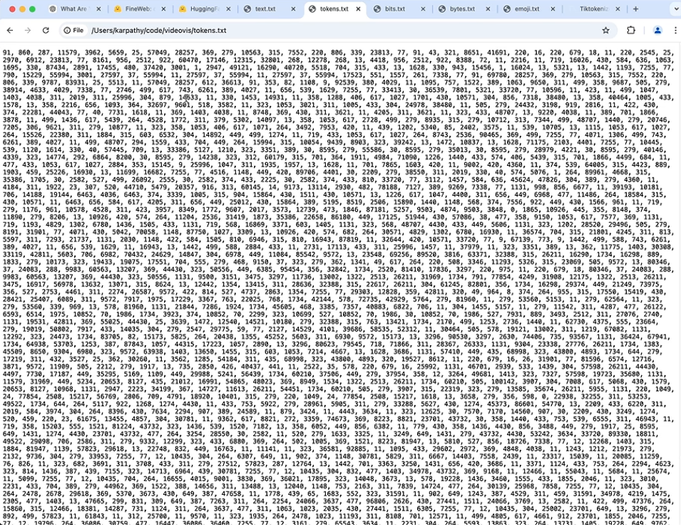

# PRETRAINING

There are multiple stage to build an LLM like ChatGPT. The second stage is called Tokenization.

## Step2: Tokenization

- Andrej shows example of the final text that ends up in the training set for FineWeb (https://huggingface.co/datasets/HuggingFaceFW/fineweb).
- He took the first 200 webpages of the dataset and concatenated them and saved them in a single file.

- So our goal here is: Take this raw text, and then train a NN so that NN can internalize and model how this text flows and it can learn the pattern in the dataset.
- Before we feed the text in NN, we have to decide how to represent this text.
    - So, NN expect a 1-dimensional sequence of symbols, and they want a finite set of symbols that are possible.
 
- Right now, we have 1-D sequence of text. And there is an underlying representation here. So if we convert the characters to their bit-representation using 8-bit, then we will have a long sequence of 0s nd 1s (with only two symbols). Instead, we want a shorter sequence with more symbols.
    - One naive way is to convert this 8-bit to bytes. So this sequence of bytes will be 8 times shorter, and now we will have 256 possible symbols.
 
- In production, in state of the art models, we actually want to go beyond this. We want to continue to shrink the length of the sequence, in return for more symbols in your vocabulary.
- The way it is done is by running the **byte-pair encoding algorithm**, and it works by looking at consecutive bytes or symbols which are vey common. E.g., in our data example, the combination `116->32` is quite common, we want we will do is pair them into a new symbol. We will mint the symbol with an id 256, and we will rewrite every single pair `116-32` with this new id.
- We can iterate the algorithm as many times we wish. Each time we mint a symbol, we are **decreasing the length and increasing the symbol size**.
- In practice, GPT-4 uses 100,277 symbols.

This process of converting raw text into symbols or tokens is called Tokenization.

### How GPT-4 does tokenization:

- One website we can use is Tiktokenizer (https://tiktokenizer.vercel.app/)
So select "cl100k_base', which is the GPT-4 base model tokenizer.

{style="border: 2px solid black;"}

So, `hello world.?` is 3 tokens. `hello` is 1 token, `<space>world` is another, and `.?` is last.

- Also, this is case-sensitive.

### Converted text to tokens

- Andrej has re-represented the dataset using GPT-4 tokenizer, and it looks like below -

{style="border: 2px solid black;"}

- As we are using a small sample dataset, we have less tokens in our data. The original FineWeb dataset has 15-trillion tokens and takes 44TB disk space!!!
- The numbers here are little text chunks, and they are just unique IDs.

(We will come back to Tokenization later)
